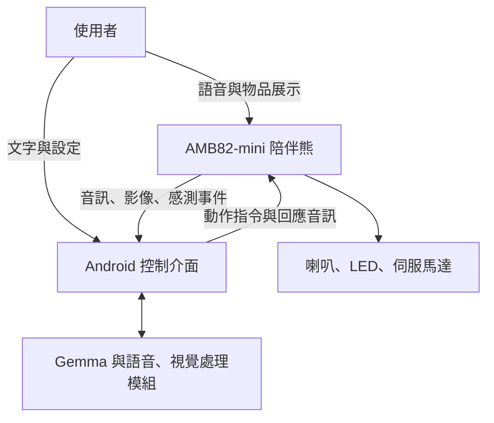

# AI Companion Bear：AI 多模態互動陪伴熊

## 一、專題基本資料

- 專題名稱：AI 多模態互動陪伴熊
- 組員姓名與學號：盧振祐（01253107）、劉祈均（01253113）、藍子安（01253112）
- 硬體控制器：AMB82-mini
- AI 運算平台：Android 手機／平板
- 專案階段：設計規劃，以下為預計實作內容

## 二、設計動機

一般 AI 聊天工具主要透過手機畫面與使用者互動，缺少實體角色的陪伴感。本計畫將語音對話、視覺問答、感測器與表情動作整合至絨毛熊，打造適合放在書桌上的 AI 互動裝置。

使用者可直接對小熊說話、展示物品，或請它協助設定讀書時間。系統依據對話與感測資訊選擇工具，透過語音、燈光及動作回應，建立具有角色個性與情境感知能力的陪伴體驗。

## 三、預計功能

| 功能 | 說明 |
|---|---|
| 自然語音對話 | 接收使用者語音，產生回答，支援同一工作階段的連續追問 |
| 視覺辨識與問答 | 按需拍攝物品，回答「我手上拿的是什麼？」等問題 |
| 表情與動作回饋 | 依回應內容搭配 LED 燈效、點頭與轉頭 |
| 讀書陪伴模式 | 透過自然語言設定專注時間，提供開始鼓勵及休息提醒 |
| 感測主動互動 | 偵測使用者靠近或裝置被拿起，觸發適當反應 |
| 手機輔助介面 | 提供文字輸入、模式切換、裝置狀態及手動控制 |

核心優先完成語音對話、視覺問答與表情動作，再整合讀書計時及主動互動。

## 四、系統架構

採用手機與硬體分工的架構：

- Android 手機／平板：執行 AI 推論、語音辨識、視覺處理、工具選擇及語音合成。
- AMB82-mini：負責影像與音訊擷取、感測器讀取、聲音播放、LED 及伺服控制。
- Wi-Fi：傳輸影像、音訊、感測事件及控制命令。

依老師提供的方向，預計評估 Google AI Edge Gallery 與 Gemma 系列模型。實際模型版本、手機相容性與工具介接能力，於開發初期確認。

大型語言模型不直接部署於 AMB82-mini。語音辨識、視覺與語音合成依需求使用相容模組，必要時自行開發手機端橋接程式。

## 五、兩種互動方式比較

| 比較項目 | 手機 App 互動 | 直接對陪伴熊說話 |
|---|---|---|
| 輸入來源 | 手機文字或麥克風 | 陪伴熊麥克風 |
| AI 運算位置 | 手機／平板 | 手機／平板 |
| 優點 | 操作清楚、方便除錯 | 自然且具有角色陪伴感 |
| 整合難度 | 較低 | 需整合收音、傳輸與播放 |
| 本專案定位 | 開發與輔助控制介面 | 最終主要互動方式 |

兩種介面共用相同控制工具。先驗證手機文字操作，再完成直接語音互動。

## 六、Agent 工具設計

預計提供以下工具，由 AI 根據使用者需求選擇：

| 工具 | 用途 |
|---|---|
| capture_image() | 拍攝影像供辨識與問答 |
| get_sensors() | 查詢距離及 IMU 資料 |
| set_expression(emotion) | 設定燈效與角色狀態 |
| perform_action(action) | 執行點頭、轉頭等預設動作 |
| play_sound(sound_id) | 播放預錄音效 |
| start_focus_timer(minutes) | 建立專注計時 |
| cancel_focus_timer() | 取消計時 |
| get_status() | 查詢裝置與任務狀態 |

工具需由本專案實作。控制程式驗證工具名稱及參數後才執行，並回報成功或失敗；AI 不直接控制任意 GPIO 或 PWM。

計時由程式執行，AI 負責理解時間與選擇工具，避免僅口頭回覆而未建立任務。

## 七、使用情境

### 情境一：視覺問答

使用者拿著書本問：「我手上拿的是什麼？」

系統拍照、辨識物品並產生回答，小熊播放語音並搭配點頭。不確定時請使用者重新展示，不任意猜測。

### 情境二：讀書陪伴

使用者說：「陪我讀書二十五分鐘。」

系統解析時間、建立計時任務，確認成功後播放鼓勵並切換燈效。時間到後提醒休息，使用者也可提前取消。

### 情境三：主動互動

感測器偵測有人靠近時，小熊依目前模式決定打招呼或僅顯示燈效。加入冷卻時間，避免重複觸發。

## 八、硬體與軟體需求

### 硬體

- AMB82-mini 與相容攝影、收音配置
- 相容音訊輸出電路、放大器與喇叭
- microSD 卡
- 小型伺服馬達與固定機構
- RGB LED
- 外接 IR 距離感測器及 IMU
- Android 手機／平板
- 合適電源與絨毛熊外殼

實際腳位、音訊格式、周邊電壓及供電能力須於接線前確認。

### 軟體

- AMB82-mini 韌體開發環境
- Android AI 應用與介接程式
- 相容 Gemma 模型
- 語音辨識、視覺辨識及 TTS 模組
- HTTP／JSON 控制介面
- GitHub 版本管理與文件

## 九、專題特色

1. 將老師的長頸鹿範例改為學生書桌情境的陪伴熊。
2. 結合語音、視覺、感測與動作，建立一致的角色反應。
3. 讓 AI 透過工具完成計時、拍照等實際任務。
4. 設計一般、專注與安靜模式，調整主動互動方式。
5. 移除輪式移動與導航，集中開發互動品質及角色表現。

## 十、預計時程

| 階段 | 工作 |
|---|---|
| 第 1 週 | 確認硬體、手機、模型相容性與 Wi-Fi |
| 第 2 週 | 完成音效、LED、伺服及手動控制 |
| 第 3 週 | 整合 AI 文字對話與工具呼叫 |
| 第 4 週 | 完成收音、語音辨識與回應播放 |
| 第 5 週 | 整合視覺問答 |
| 第 6 週 | 整合計時、感測事件及模式切換 |
| 第 7 週 | 外觀組裝、測試修正與展示文件 |

實際時程依課程期限調整。

## 十一、組員分工

| 姓名／學號 | 預計分工 |
|---|---|
| 盧振祐／01253107 | AMB82-mini 韌體、感測器、音訊與動作控制 |
| 劉祈均／01253113 | AI 對話、語音流程與手機端工具介接 |
| 藍子安／01253112 | 手機控制介面、外觀整合與文件整理 |
| 共同負責 | 系統整合、測試與展示 |

## 十二、驗收規劃

以下為預定目標，完成後另填實測結果。

- 工具控制：10 次指定指令中，至少 9 次正確執行。
- 語音互動：安靜環境下，10 次測試至少 8 次完成輸入至回應播放。
- 視覺問答：5 類常見物品各測 2 次，至少 8 次正確，並記錄測試條件。
- 連續對話：完成 3 組各至少 3 輪的追問測試。
- 計時功能：可建立、查詢、取消計時，並在到時後提醒。
- 異常處理：斷線或工具失敗時正確回報，不宣稱執行成功。
- 延遲量測：記錄語音與視覺流程的回應時間。

## 十三、風險與備案

- App 或模型介接能力不足：補充橋接程式，若需更換方案則與老師確認。
- 播放聲音干擾收音：採半雙工互動，播放期間暫停錄音。
- 視覺辨識不穩定：先以固定物品集測試，清楚揭露辨識範圍。
- 即時 TTS 尚未完成：先用預錄音訊驗證硬體，明確標示未完成部分。
- 感測器重複觸發：加入門檻、去抖動及冷卻時間。

## 十四、預期成果

- AI 互動陪伴熊硬體原型
- AMB82-mini 韌體與 Android 介接程式
- 語音、視覺與表情動作展示
- 測試紀錄與已知限制
- PROPOSAL.md、README.md、架構圖及 AI 生成外觀概念圖

