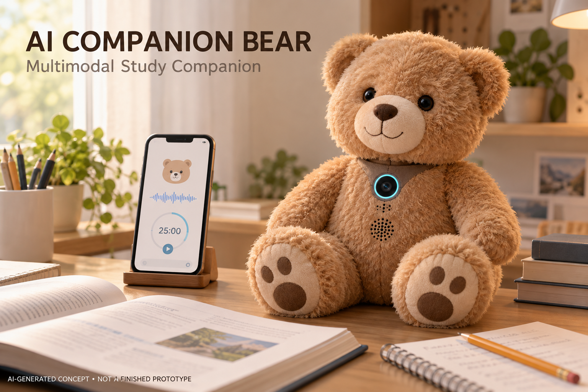
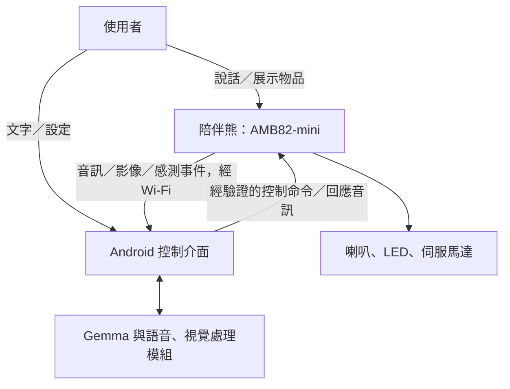

# AI Companion Bear｜AI 多模態互動陪伴熊

結合語音對話、視覺問答、感測器與表情動作的桌上型 AI 陪伴裝置。

> 本專案目前為期末專題規劃階段，以下功能為預計實作內容。

## 外觀概念圖

> 此圖由 AI 生成，呈現預期外觀與使用情境；實際硬體配置及成品外觀依製作結果調整。

## 專案介紹

AI Companion Bear 以絨毛熊作為互動角色，讓使用者透過說話、展示物品與感測事件，獲得語音、燈光及動作回饋。

本專案聚焦於學生書桌上的日常互動與讀書陪伴。使用者可以請小熊辨識物品、進行對話，或設定專注時間。AI 根據需求選擇工具，裝置執行後回傳結果，形成「感知、理解、執行與確認」的互動流程。

系統預計使用 **AMB82-mini 作為硬體控制器**，並由 Android 手機／平板執行 AI 推論及相關處理。

## 主要功能

| 功能 | 預計行為 |
|---|---|
| 自然語音對話 | 直接對小熊說話，支援同一工作階段的連續追問 |
| 視覺問答 | 按需拍照，回答眼前物品相關問題 |
| 表情與動作 | 搭配 LED 燈效、點頭與轉頭，呈現角色反應 |
| 讀書陪伴 | 設定專注時間，提供鼓勵及休息提醒 |
| 主動互動 | 偵測有人靠近或小熊被拿起，觸發適當回應 |
| 手機輔助控制 | 文字輸入、模式切換、裝置狀態及手動操作 |

## 系統架構

### 運算分工

| 系統部分 | 負責內容 |
|---|---|
| Android 手機／平板 | 語音辨識、AI 對話、視覺處理、工具選擇及語音合成 |
| AMB82-mini | 影像與音訊擷取、感測器讀取、播放聲音及控制動作 |
| Wi-Fi 通訊 | 傳輸控制命令、感測事件及所需媒體資料 |

預計評估 Google AI Edge Gallery 與 Gemma 系列模型。實際版本、手機相容性與工具介接能力將於開發初期確認，必要時自行實作橋接程式。

語音辨識、視覺辨識與語音合成依需求使用相容模組，大型語言模型不直接部署於 AMB82-mini。

## 互動流程範例

### 視覺問答

1. 使用者展示書本，詢問：「我手上拿的是什麼？」
2. 系統呼叫拍照工具，取得影像。
3. 視覺模組辨識物品，AI 組織回答。
4. 小熊播放回應，搭配燈效及點頭。
5. 若無法確認，請使用者重新展示物品。

### 讀書陪伴

1. 使用者說：「陪我讀書二十五分鐘。」
2. AI 解析需求，呼叫計時工具。
3. 程式確認任務建立成功後，小熊回覆並進入專注模式。
4. 時間到後播放休息提醒。
5. 使用者可查詢或取消計時。

## 雙介面設計

| 介面 | 主要用途 |
|---|---|
| 直接對小熊說話 | 日常對話、視覺問答及自然互動 |
| 手機介面 | 初期測試、文字操作、設定與裝置狀態查詢 |

兩種介面共用相同工具。開發時先完成手機文字控制，再接入小熊收音與語音回放。

## 預計硬體

| 硬體 | 用途 |
|---|---|
| AMB82-mini 與相容攝影、收音配置 | 影像、聲音、Wi-Fi 及硬體控制 |
| 音訊輸出電路、放大器與喇叭 | 播放語音及音效 |
| microSD 卡 | 預錄音效與資料暫存 |
| 小型伺服馬達 | 點頭、轉頭等預設動作 |
| RGB LED | 顯示互動狀態 |
| 外接 IR 距離感測器 | 偵測使用者靠近 |
| 外接 IMU | 偵測拿起或姿態變化 |
| Android 手機／平板 | AI 與語音、視覺處理 |
| 合適電源、固定機構及絨毛外殼 | 供電與外觀整合 |

實際零件、腳位與供電配置依相容性測試確認。

## 工具介面規劃

| 工具 | 功能 |
|---|---|
| `capture_image()` | 按需拍照 |
| `get_sensors()` | 取得感測資料 |
| `set_expression(emotion)` | 設定燈效 |
| `perform_action(action)` | 執行預設動作 |
| `play_sound(sound_id)` | 播放指定音效 |
| `start_focus_timer(minutes)` | 建立專注計時 |
| `cancel_focus_timer()` | 取消計時 |
| `get_status()` | 查詢裝置及任務狀態 |

以上為預計自行實作的介面。控制程式檢查工具名稱、參數及執行結果，再將狀態回報給 AI。

## 專案特色

- 結合語音、視覺與實體動作，建立具有個性的陪伴角色。
- 將自然語言轉為可執行、可查詢的工具任務。
- 設計一般、專注與安靜模式，調整主動互動方式。
- 以手機負責高階推論，AMB82-mini 負責硬體控制。
- 聚焦桌上互動，不加入輪式移動與導航。

## 開發規劃

- [x] 專題方向與計畫書初稿
- [x] AI 外觀概念圖
- [x] 確認組員與分工
- [ ] 確認硬體、模型及手機相容性
- [ ] Wi-Fi 與手動工具控制
- [ ] LED、伺服與音訊整合
- [ ] AI 對話與工具介接
- [ ] 直接語音互動
- [ ] 視覺問答
- [ ] 計時、感測事件及模式切換
- [ ] 系統驗收與展示

## 組員

| 姓名／學號 | 預計分工 |
|---|---|
| 陳綉穎／01253008 | AI 對話、語音流程、手機端工具介接與文件整理 |
| 盧振祐／01253107 | AMB82-mini 韌體、感測器、音訊與動作控制 |
| 共同負責 | 外觀組裝、系統整合、測試與展示 |

## 完整計畫書

詳見 [PROPOSAL.md](PROPOSAL.md)。

## 參考來源與 AI 協助

本專案由老師的 [AI-plush-giraffe](https://github.com/rkuo2000/AI-plush-giraffe) 範例 Fork，並參考課程提供的 AI RoboCar／Plush Pet 提案。

本計畫將角色改為陪伴熊，加入讀書計時、互動模式與相應驗收規劃。文件草稿與外觀概念圖使用 ChatGPT 協助製作，實作內容及成果將依測試更新。

倉庫中其餘繼承的範例檔案尚待逐項確認與調整。
